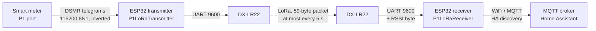
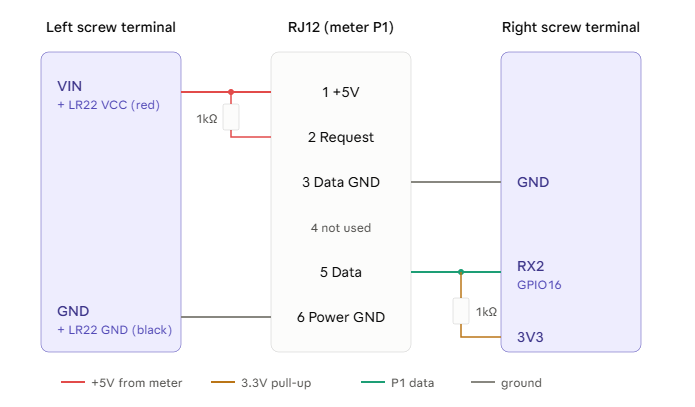
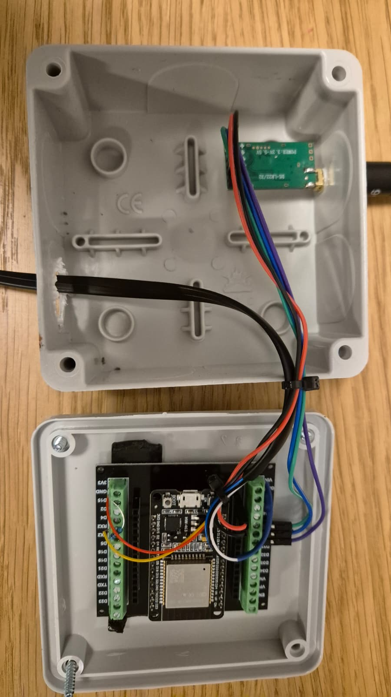
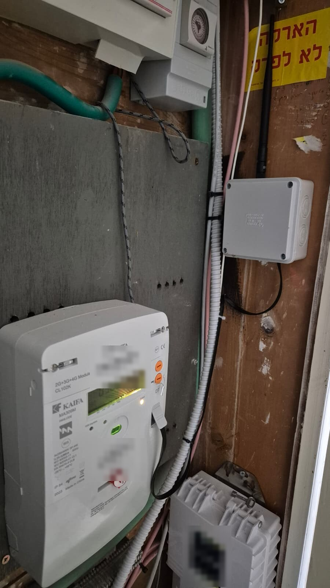

# Zat

A two-board LoRa bridge for a P1 (DSMR) smart electricity meter. One ESP32 sits at the meter,
reads the P1 port and sends every valid reading over a DX-LR22 LoRa modem. A second ESP32 near
your WiFi receives the readings and publishes them to MQTT with Home Assistant discovery.

It is meant for homes where the meter is out of WiFi range (a basement, a meter cabinet,
another building). The transmitter keeps WiFi and Bluetooth off.

The Home Assistant entities keep the names used by an earlier ESPHome version of this project
(device "Electricity meter", so `sensor.electricity_meter_power`,
`sensor.electricity_meter_energy_total`, …). Dashboards and automations built for that version
keep working once the old ESPHome device is removed from Home Assistant. The new entities have
new unique IDs, so while the old ones are still registered, Home Assistant names the new ones
`sensor.electricity_meter_power_2` and so on.
<!-- TODO: verify: link to the ESPHome project this replaces -->

## Contents

- [Features](#features)
- [How it works](#how-it-works)
- [Hardware](#hardware)
- [Wiring](#wiring)
  - [The transmitter build](#the-transmitter-build)
- [Installation](#installation)
- [Configuration](#configuration)
- [Home Assistant and MQTT](#home-assistant-and-mqtt)
- [Radio packet format](#radio-packet-format)
- [Security notes](#security-notes)
- [Troubleshooting](#troubleshooting)
- [Project layout](#project-layout)
- [Contributing](#contributing)
- [License](#license)

## Features

- **Reads the P1 port directly.** The ESP32 inverts the UART itself on GPIO16, so you don't
  need a transistor or an inverter chip. Two resistors and an RJ12 cable are all the extra
  hardware it needs.
- **Checks the telegram CRC.** Each telegram's CRC16 is checked, and a reading is used only if
  it matches. Dropped telegrams (bad CRC or cut off) are counted and reported to Home
  Assistant as `P1 CRC errors`.
- **No float rounding.** Values are parsed and sent as fixed-point integers (Wh, W, 0.1 V,
  0.01 A), so kWh totals keep all three decimals.
- **Compact radio packets.** Each reading is 59 bytes with a CRC-8, a sequence number and a
  network ID, so several transmitter/receiver pairs can share a channel.
- **Sets up the modem by itself.** At every boot, each ESP32 puts its DX-LR22 into AT mode,
  reads every setting and changes only the ones that differ from `config.h`.
- **Home Assistant MQTT discovery.** 22 sensors plus a `LoRa link` connectivity sensor, with
  retained states. Discovery is sent again when Home Assistant restarts.
- **Availability tracking:**
  - Meter entities become unavailable when no meter data arrives for 20 s.
  - The `LoRa link` sensor turns off after 75 s without any packet.
  - An MQTT Last Will marks the whole bridge offline if the receiver disconnects.
- **Heartbeat while the meter is silent.** The transmitter sends a small status packet every
  60 s, so you can tell "meter silent" apart from "radio link down".
- **Test mode.** The transmitter can send changing mock readings, so you can test the radio
  link and Home Assistant without a meter.
- **OTA updates.** The receiver supports Arduino OTA, with an optional password.

## How it works



1. **Transmitter** (`P1LoRaTransmitter`): reads DSMR telegrams from the meter and drops any
   with a bad CRC. Every 5 s (`TX_PERIOD_MS`) it sends the newest valid reading, but only when
   a new telegram has arrived since the last packet.
   - Readings older than 30 s (`P1_STALE_MS`) are not sent.
   - While no fresh data exists, it sends a status packet (no meter values) every 60 s
     (`STATUS_PERIOD_MS`).
2. **Receiver** (`P1LoRaReceiver`): drops packets that are malformed or carry another network
   ID. It publishes each value to MQTT and adds two computed values, `Energy Total` and
   `Export Total` (T1 + T2 + T3). It also reports the LoRa RSSI of each packet and the
   transmitter's P1 CRC error count. Readings that arrive while the receiver is disconnected
   from MQTT are logged to serial but not buffered or published.

## Hardware

| Part | Qty | Notes |
|------|-----|-------|
| ESP32-WROOM DevKit | 2 | One at the meter, one within WiFi range. Pin numbers in `config.h` assume a DevKit. |
| DX-SMART DX-LR22-900T22D | 2 | UART LoRa modem (LLCC68). The driver follows the module's "serial port application guide" v2.2. |
| RJ12 cable (6P6C) | 1 | From the meter's P1 port to the transmitter ESP32. Use a 6-wire cable: the transmitter takes its power from pins 1 and 6. |
| Resistor, 1 kΩ | 1 | Between P1 pin 1 (+5V) and pin 2 (Data Request), so the meter sends telegrams. |
| Resistor, 1 kΩ | 1 | Pull-up between GPIO16 (RX2, P1 Data) and 3.3V on the transmitter ESP32. |
| Smart meter with a P1 port | 1 | The parser targets the IEC Kaifa three-phase meter (see below). |

The transmitter is meant to be powered from the meter's P1 port (see the comment at the top of
`P1LoRaTransmitter.ino`). Check that your meter's P1 port can supply the ESP32 plus the LR22
at your transmit power. The receiver needs a 2.4 GHz WiFi network.

**Meter compatibility.** The parser reads these OBIS codes:

| OBIS | Value |
|------|-------|
| `1-0:1.8.11` / `1.8.12` / `1.8.13` | Energy imported, tariffs T1–T3 (kWh) |
| `1-0:2.8.11` / `2.8.12` / `2.8.13` | Energy exported, tariffs T1–T3 (kWh) |
| `0-0:96.14.1` | Active tariff |
| `1-0:1.7.0` / `1-0:2.7.0` | Power imported / exported (kW) |
| `1-0:21.7.0` / `41.7.0` / `61.7.0` | Power L1 / L2 / L3 (kW) |
| `1-0:32.7.0` / `52.7.0` / `72.7.0` | Voltage L1 / L2 / L3 (V) |
| `1-0:31.7.0` / `51.7.0` / `71.7.0` | Current L1 / L2 / L3 (A) |

Meters that use other codes (for example the Dutch `1-0:1.8.1` / `1.8.2` tariffs) won't fill
the energy fields unless you change `P1_FIELDS` in `p1_packet.cpp` on both sides.

## Wiring

Both boards wire the LR22 the same way:

| LR22 pin | ESP32 pin | `config.h` |
|----------|-----------|------------|
| TXD | GPIO26 (ESP32 RX) | `PIN_LR22_RX` |
| RXD | GPIO27 (ESP32 TX) | `PIN_LR22_TX` |
| AUX | GPIO25 | `PIN_LR22_AUX` |
| M0, M1 | not connected | `AT+SWITCH0` makes them module outputs |
| VCC | ESP32 VIN (5V) | The module board is marked 3.3–5.5 V. |
| GND | ESP32 GND | |

The transmitter also connects to the meter's P1 port with an RJ12 (6P6C) cable. In this build
the ESP32 sits on a screw-terminal breakout board, and the LR22 power wires share the VIN and
GND terminals with the P1 power:



| P1 pin (RJ12) | Signal | Connect to |
|---------------|--------|------------|
| 1 | +5V | ESP32 5V (VIN), and through a 1 kΩ resistor to pin 2 |
| 2 | Data Request | Through a 1 kΩ resistor to pin 1 (+5V); this enables the P1 output |
| 3 | Data GND | ESP32 GND |
| 4 | not used | — |
| 5 | Data | GPIO16 (RX2, `PIN_P1_RX`), with a 1 kΩ pull-up resistor to 3.3V |
| 6 | Power GND | ESP32 GND |

The pull-up is needed because P1 Data is an open-collector output. Pulling it up to 3.3V, not
5V, keeps the signal safe for the ESP32 input. The signal is still inverted in software, so no
transistor or inverter is needed. The pin numbers follow the DSMR P1 standard; check your
meter's documentation if it differs.

### The transmitter build

| Inside the enclosure | Installed at the meter |
|:---:|:---:|
|  |  |

## Installation

The firmware is two Arduino sketches. There is no PlatformIO project and no prebuilt binary.

### Requirements

- Arduino IDE or `arduino-cli` with the **ESP32 Arduino core** (Espressif). The code is kept
  C++11-compatible so it also builds on core 2.x.
- The **PubSubClient** library (by Nick O'Leary), for the receiver only. `WiFi` and
  `ArduinoOTA` come with the ESP32 core.
- An MQTT broker, such as the Mosquitto add-on in Home Assistant, with the
  [MQTT integration](https://www.home-assistant.io/integrations/mqtt/) enabled.

### 1. Configure

1. Pick a `NETWORK_ID`, LoRa channel and air rate, and set them **the same** in
   `P1LoRaTransmitter/config.h` and `P1LoRaReceiver/config.h`. Each sketch has its own copy of
   `config.h`. See [Configuration](#configuration).
2. Fill in `P1LoRaReceiver/secrets.h` (WiFi, MQTT, OTA). Don't commit it with real values;
   see [Security notes](#security-notes).

### 2. Flash the transmitter

Arduino IDE: open `P1LoRaTransmitter/P1LoRaTransmitter.ino`, select **ESP32 Dev Module**, and
upload.

```bash
arduino-cli compile --fqbn esp32:esp32:esp32 P1LoRaTransmitter
arduino-cli upload  --fqbn esp32:esp32:esp32 -p /dev/ttyUSB0 P1LoRaTransmitter
```

To test the link before you go to the meter, set `TEST_MODE` to `1` in
`P1LoRaTransmitter/config.h`. The transmitter then ignores the P1 port and sends mock readings
every 5 s. Set it back to `0` before you connect the real meter.

### 3. Flash the receiver

```bash
arduino-cli lib install PubSubClient
arduino-cli compile --fqbn esp32:esp32:esp32 P1LoRaReceiver
arduino-cli upload  --fqbn esp32:esp32:esp32 -p /dev/ttyUSB0 P1LoRaReceiver
```

Later updates can be sent over WiFi with Arduino OTA, using `OTA_HOSTNAME` and
`OTA_PASSWORD`.

### 4. Check the serial logs

Both boards log at 115200 baud (`LOG_BAUD`). On a working setup you will see lines like:

```text
# transmitter
LR22 ready (0 setting(s) changed)
P1 ok #12 fields=0x3FFFF P=1234W T1=12345678Wh
TX seq=13 data

# receiver
WiFi connected, IP ...
MQTT connecting... ok
MQTT discovery published
RX seq=13 fields=0x3FFFF RSSI=-62 received=13 lost=0
```

## Configuration

All settings are compile-time `#define`s. Five of them can also be overridden with a build
flag instead of editing `config.h`: `LR22_LEVEL`, `LR22_CHANNEL`, `LR22_POWER_DBM`,
`NETWORK_ID` and `TEST_MODE` (transmitter only), for example `-DNETWORK_ID=0xA102`. The
`LR22_*` values are C strings (`"3"`), so a flag must keep the quotes, e.g. `-DLR22_LEVEL=\"2\"`.
Each sketch is built separately, so pass the same pairing flags to both builds. All other
settings (pins, timing, MQTT, `secrets.h`) must be changed in the files.

### Radio and pairing (`config.h`, both sketches)

| Define | Transmitter default | Receiver default | Description |
|--------|---------------------|------------------|-------------|
| `LR22_LEVEL` | `"3"` | `"3"` | Air-rate level 0–7 (table below). **Must match on both sides.** |
| `LR22_CHANNEL` | `"41"` | `"41"` | Channel as two hex digits: 850.15 MHz + channel × 1 MHz. `41` (hex) = 915.15 MHz, the module default. **Must match.** Use a frequency your local regulations allow. |
| `LR22_POWER_DBM` | `"20"` | `"10"` | Transmit power, 0–22 dBm. It can differ per side; the receiver sends nothing. |
| `NETWORK_ID` | `0xA101` | `0xA101` | 16-bit pair ID. Packets with another ID are ignored. **Must match.** |
| `TEST_MODE` | `0` | — | Transmitter only. `1` sends mock readings instead of reading P1. |

Air-rate levels, from the DX-LR22 application guide (5.3.2):

| Level | Modulation | Rate | Level | Modulation | Rate |
|-------|-----------|------|-------|-----------|------|
| 0 | SF11 / 125 kHz | 336 bps | 4 | SF8 / 500 kHz | 10417 bps |
| 1 | SF11 / 250 kHz | 1075 bps | 5 | SF7 / 500 kHz | 18229 bps |
| 2 | SF11 / 500 kHz | 2148 bps | 6 | SF6 / 500 kHz | 37500 bps |
| 3 | SF8 / 250 kHz | 6250 bps | 7 | SF5 / 500 kHz | 62500 bps |

At level 3 a 59-byte reading takes about 0.1 s on air. Lower levels reach further but take
longer per packet.

Each board also applies these fixed LR22 settings at boot (`lr22_esp32.h`): `MODE0`
(transparent), `SLEEP2` (always receiving), `SWITCH0` (M0/M1 ignored), `PACKET3` (230-byte
sub-packets, so one reading is one LoRa packet), `CRC1`, `IQ1`. `DRSSI` is `1` on the receiver
(the module adds an RSSI byte after each packet) and `0` on the transmitter.

### Pins and serial ports (`config.h`)

| Define | Default | Description |
|--------|---------|-------------|
| `PIN_LR22_RX` | `26` | ESP32 RX, from LR22 TXD |
| `PIN_LR22_TX` | `27` | ESP32 TX, to LR22 RXD |
| `PIN_LR22_AUX` | `25` | LR22 AUX (high while the module is busy) |
| `LR22_BAUD` | `9600` | LR22 UART speed (module default; not changed) |
| `PIN_P1_RX` | `16` | P1 Data input (transmitter) |
| `P1_BAUD` | `115200` | P1 UART speed (8N1, inverted) |
| `LOG_BAUD` | `115200` | USB serial log speed |

### Timing (`config.h`)

| Define | Default | Used by | Description |
|--------|---------|---------|-------------|
| `TX_PERIOD_MS` | `5000` | transmitter | Minimum time between packets |
| `P1_STALE_MS` | `30000` | transmitter | Readings older than this are not sent |
| `STATUS_PERIOD_MS` | `60000` | transmitter | Status packet interval while P1 is silent |
| `METER_TIMEOUT_MS` | `20000` | receiver | Meter entities unavailable after this without data |
| `LINK_TIMEOUT_MS` | `75000` | receiver | `LoRa link` turns off after this without any packet |

Keep `LINK_TIMEOUT_MS` longer than `STATUS_PERIOD_MS`, or the link sensor will drop between
status packets while the meter is silent.

### MQTT and Home Assistant (`config.h`, receiver)

| Define | Default | Description |
|--------|---------|-------------|
| `MQTT_BASE_TOPIC` | `"p1lora"` | Topic prefix; topics are `p1lora/<network id>/...` |
| `HA_DISCOVERY_PREFIX` | `"homeassistant"` | Home Assistant discovery prefix |
| `HA_DEVICE_NAME` | `"Electricity meter"` | Device name; entity IDs become `sensor.electricity_meter_*` |

### Credentials (`secrets.h`, receiver)

| Define | Default | Description |
|--------|---------|-------------|
| `WIFI_SSID` | `""` | WiFi network (2.4 GHz) |
| `WIFI_PASSWORD` | `""` | WiFi password |
| `MQTT_HOST` | `""` | Broker host name or IP |
| `MQTT_PORT` | `1883` | Broker port (plain TCP; TLS is not supported) |
| `MQTT_USER` | `""` | Broker user name; set it to `nullptr` if the broker allows anonymous clients |
| `MQTT_PASS` | `""` | Broker password |
| `OTA_HOSTNAME` | `""` | Hostname for WiFi and Arduino OTA. Set a value, e.g. `p1lora-receiver`. |
| `OTA_PASSWORD` | `""` | OTA password; `""` means no password |

## Home Assistant and MQTT

### Topics

With the defaults (`NETWORK_ID 0xA101`) the base topic is `p1lora/a101`, and the MQTT client
ID and discovery node ID are `p1lora_a101`. All states are published **retained**, so Home
Assistant gets the last values after a restart.

| Topic | Payload | Meaning |
|-------|---------|---------|
| `p1lora/a101/bridge` | `online` / `offline` | Receiver connected to MQTT (`offline` is the Last Will) |
| `p1lora/a101/meter` | `online` / `offline` | Meter data received in the last `METER_TIMEOUT_MS` |
| `p1lora/a101/link` | `ON` / `OFF` | Any packet received in the last `LINK_TIMEOUT_MS` |
| `p1lora/a101/<key>` | number | One topic per entity below |

Discovery configs go to `homeassistant/sensor/p1lora_a101/<key>/config` and
`homeassistant/binary_sensor/p1lora_a101/link/config`. The receiver subscribes to
`homeassistant/status` and publishes discovery again when Home Assistant reports `online`.

### Entities

| Key | Name | Unit | Device class | State class |
|-----|------|------|--------------|-------------|
| `energy_t1`, `energy_t2`, `energy_t3` | Energy T1–T3 | kWh | energy | total_increasing |
| `export_t1`, `export_t2`, `export_t3` | Export T1–T3 | kWh | energy | total_increasing |
| `energy_total` | Energy Total (sum of T1–T3) | kWh | energy | total_increasing |
| `export_total` | Export Total (sum of T1–T3) | kWh | energy | total_increasing |
| `power` | Power | kW | power | measurement |
| `power_export` | Power Export | kW | power | measurement |
| `power_l1`, `power_l2`, `power_l3` | Power L1–L3 | kW | power | measurement |
| `voltage_l1`, `voltage_l2`, `voltage_l3` | Voltage L1–L3 | V | voltage | measurement |
| `current_l1`, `current_l2`, `current_l3` | Current L1–L3 | A | current | measurement |
| `tariff` | Active Tariff | — | — | — |
| `rssi` | LoRa RSSI *(diagnostic)* | dBm | signal_strength | measurement |
| `p1_crc_errors` | P1 CRC errors *(diagnostic)* | — | — | total_increasing |
| `link` | LoRa link *(diagnostic, binary sensor)* | — | connectivity | — |

The meter entities are available only while both `bridge` and `meter` are `online`.
Diagnostic entities depend only on `bridge`, so you can still see the RSSI and link state when
the meter is silent. `Energy Total` and `Export Total` are only published when all three
tariff values are present.

For the Home Assistant **Energy dashboard**, use `Energy Total` as grid consumption and
`Export Total` as return to grid. You can also add the per-tariff sensors separately.

## Radio packet format

Defined in `p1_packet.h`; little-endian, 59 bytes:

| Bytes | Content |
|-------|---------|
| 0 | Magic `0xE1` |
| 1 | Format version (`1`) |
| 2–3 | Network ID |
| 4–5 | Sequence number |
| 6–8 | Present mask (bit *i* = field *i* was in the telegram); `0` = status packet |
| 9–10 | P1 telegrams dropped (bad CRC or cut off) since the transmitter started; 16-bit, wraps |
| 11–34 | Energy imported T1–T3 and exported T1–T3, 6 × uint32 Wh |
| 35 | Active tariff |
| 36–45 | Power import, export, L1, L2, L3, 5 × uint16 W |
| 46–51 | Voltage L1–L3, 3 × uint16 in 0.1 V |
| 52–57 | Current L1–L3, 3 × uint16 in 0.01 A |
| 58 | CRC-8 (poly `0x07`) over bytes 0–57 |

Values too large for their field are clamped. Power fields are 16-bit, so anything over
65.535 kW is sent as 65535 W.

The receiver counts gaps in the sequence numbers as lost packets and shows the count in its
serial log. A jump of 1000 or more is treated as a transmitter restart.

## Security notes

- **Keep credentials out of git.** `P1LoRaReceiver/secrets.h` is tracked with empty values.
  Once you fill it in, `git add -A` or `git commit -a` will pick it up. To stop tracking local
  changes, run `git update-index --skip-worktree P1LoRaReceiver/secrets.h`.
- **The radio link has no encryption or authentication.** Packets have a CRC-8 and a network
  ID, but no encryption or signature. Anyone in range can read your meter values, or send
  packets with your network ID that the receiver will accept. Treat the values as
  informational, not as a control or billing source.
- **MQTT is plain TCP.** There is no TLS support. Keep the broker on your LAN and use a
  dedicated MQTT user.
- **Set an OTA password.** With an empty `OTA_PASSWORD`, anyone on the LAN can flash new
  firmware to the receiver.

## Troubleshooting

| Log message | Likely cause |
|-------------|--------------|
| `LR22: no answer to +++ (check wiring, 9600 baud)` | TXD/RXD swapped, wrong RX/TX pins, or the module isn't powered. The board keeps running with the module's current settings. |
| `LR22: <NAME> not supported here, skipped` | The module firmware doesn't know that AT command. Harmless if the remaining settings match the other side. |
| `TX seq=… FAILED: LR22 busy` | AUX stayed high for 500 ms. Check the AUX wiring. |
| `P1 telegram dropped: bad CRC` | Noise or a loose P1 cable. The count also shows in Home Assistant as `P1 CRC errors`. |
| `TX seq=… status (no P1 data)` | The transmitter gets no valid telegrams. Check the P1 Data wiring (GPIO16) and its pull-up to 3.3V, the resistor between P1 pins 1 and 2 (Data Request), the ground, and that the meter's P1 port is enabled. |
| `RX from another network (0x…), ignored` | Another pair is using the same channel. Use different `NETWORK_ID` values. |
| `RX … bytes, no valid packet` | Bytes arrived but held no valid packet: another LoRa device on the same channel and air rate, or the two sketches have different copies of `p1_packet.*`. |
| No `RX` lines at all on the receiver | The two sides have a different `LR22_LEVEL` or `LR22_CHANNEL` (the modules can't hear each other), or the transmitter isn't sending. |
| `MQTT connecting... failed, state <n>` | Wrong `MQTT_HOST`, port or credentials. `<n>` is the PubSubClient state code (e.g. `5` = not authorized). |
| Meter entities unavailable, `LoRa link` on | Status packets arrive but no meter data. See "status (no P1 data)" above. |
| All energy sensors stay empty | Your meter uses different OBIS codes. See [Hardware](#hardware). |

## Project layout

```text
P1LoRaTransmitter/
  P1LoRaTransmitter.ino   P1 reading, packet timing, test mode
  p1_telegram.{h,cpp}     DSMR telegram parser + CRC16 (no Arduino dependency)
P1LoRaReceiver/
  P1LoRaReceiver.ino      packet handling, MQTT, HA discovery, OTA
  secrets.h               WiFi / MQTT / OTA credentials
Both sketches (a copy in each folder):
  config.h                radio, pins, timing, topics
  lr22.{h,cpp}            DX-LR22 driver: AT configuration, send, frame receive
  lr22_esp32.h            LR22Port on ESP32 HardwareSerial + common LR22 settings
  p1_packet.{h,cpp}       59-byte radio packet encode/decode + CRC-8
```

Arduino builds every file in the sketch folder, so the shared files are copied into both. If
you change `lr22.*`, `lr22_esp32.h`, `p1_packet.*` or the shared part of `config.h`, change
both copies. The parser, packet and LR22 driver code doesn't depend on Arduino (the driver
goes through the `LR22Port` interface), so it can be compiled and tested on a PC.

## Contributing

Issues and pull requests are welcome. Please describe your meter model and include the serial
log from both boards when reporting a problem. Keep the shared files identical in both sketch
folders.

## License

Licensed under the [Apache License 2.0](LICENSE).
